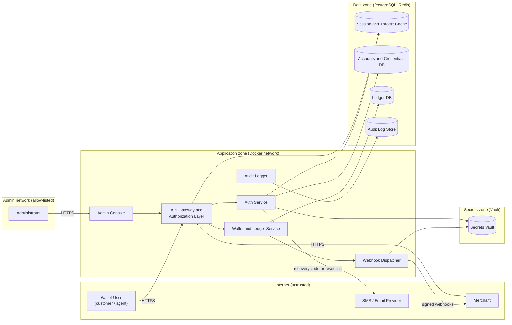

# Secure Mobile-Money Payments API — Week 1 Threat Model

**Course:** CSSS 441 Software Security I  
**Project:** Project 1 — Secure mobile-money payments API  
**Week:** Week 1 — Threat-model your project  
**Author:** Ralph Andy Menz — Level 400, BSc Software Engineering  
**Deliverables:** OWASP Threat Dragon JSON + one-page summary

## Overview

This repository contains the Week 1 threat-model deliverables for a mobile-money-style wallet API. It is not the API implementation; it is the security design artefact that later weeks will build against.

The model describes a backend with:

- registration, login and account recovery using Argon2id, TOTP and passkeys (WebAuthn);
- wallets, balances and transfers on a double-entry PostgreSQL ledger, with idempotency keys and daily limits;
- a deny-by-default authorization layer with customer, merchant, agent and admin roles;
- HMAC-SHA-256-signed merchant webhooks with replay protection;
- a hash-chained audit log with a verifier;
- an admin console restricted to an allow-listed network and protected by MFA.

## Repository contents

| Path | Description |
|---|---|
| [`threat-model/mobile-money-payments-api-threat-model.json`](threat-model/mobile-money-payments-api-threat-model.json) | OWASP Threat Dragon v2.1.2 model: level-1 DFD, 27 STRIDE threats, ratings and controls |
| [`docs/week-1-threat-model-summary.docx`](docs/week-1-threat-model-summary.docx) | One-page summary of scope, method, results and the top five threats |
| `README.md` | This overview |

## Architecture at a glance

> Simplified view. The authoritative level-1 DFD is the Threat Dragon JSON; open it in Threat Dragon to see all 19 flows and 5 trust boundaries.

### Trust boundaries

| Zone | Contains | Why it is a boundary |
|---|---|---|
| Internet (untrusted) | Wallet user, merchant, SMS/email provider | Attacker-controlled clients and third parties |
| Admin network (allow-listed) | Administrator | High-value access; membership enforced by firewall rules |
| Application zone (Docker network) | Admin console, API gateway, auth, wallet/ledger, webhook dispatcher, audit logger | Internal services; only the edge port should be published |
| Data zone (PostgreSQL, Redis) | Session cache, accounts DB, ledger DB, audit log store | Reachable only from the app zone with per-service credentials over TLS |
| Secrets zone (Vault) | Secrets Vault | Reachable only with a service identity |

## Method

- **Diagram:** level-1 data-flow diagram drawn in OWASP Threat Dragon, with every trust boundary marked.
- **Threat enumeration:** STRIDE-per-element across external entities, processes, data stores and flows.
- **Risk rating:** Likelihood × Impact on a 1–5 scale. `1–6 = Low`, `8–12 = Medium`, `15–25 = High`.
- **Coverage rule:** every flow that crosses a trust boundary has at least one threat. All 12 boundary-crossing flows are covered.

### Results

| Metric | Result |
|---|---|
| External entities | 4 |
| Processes | 6 |
| Data stores | 5 |
| Data flows | 19 |
| Trust boundaries | 5 |
| Boundary-crossing flows | 12 (all 12 have at least one threat) |
| Total threats | 27 |
| High / Medium / Low | 9 / 16 / 2 |

**STRIDE split:** Spoofing 7, Tampering 7, Repudiation 2, Information disclosure 5, Denial of service 3, Elevation of privilege 3.

## Top five threats and controls

| # | Threat | Where | L × I | Control |
|---|---|---|---|---|
| 1 | **T02** Broken object-level authorization on wallet and transaction routes | Wallet API flow | 4 × 5 = 20 High | Deny-by-default authorization: role check plus ownership check on every route, with one negative test per route in CI |
| 2 | **T14** Account takeover through the account-recovery channel | Recovery message flow | 4 × 5 = 20 High | Single-use 128-bit token stored hashed, 15-minute expiry; recovery never bypasses MFA; throttling; identical responses for known and unknown accounts |
| 3 | **T01** Credential stuffing and password guessing | Auth service | 5 × 4 = 20 High | Argon2id hashing; per-account and per-IP throttling; TOTP or passkey second factor; breached-password check |
| 4 | **T07** Retried or concurrent requests cause double payment or overdraft | Wallet/ledger service | 4 × 4 = 16 High | Idempotency key + unique constraint; database transaction with row locks; balance and daily limit checked inside the same transaction |
| 5 | **T03** Tampered request fields and injection payloads | Wallet API flow | 4 × 4 = 16 High | Strict request schemas rejecting unknown fields; parameterised queries; output encoding; Semgrep in CI |

### Other High threats

| Threat | Score | Control |
|---|---|---|
| **T08** Business-logic abuse (negative/zero amounts, rounding, currency mix-ups, self-transfers) | 15 | Integer minor units; `CHECK` constraints; double-entry invariant; property-based tests |
| **T09** Forged webhook claiming a payment succeeded | 15 | HMAC-SHA-256 over timestamp + body; per-merchant secret; constant-time verification |
| **T12** Admin allow-list bypass via spoofed `X-Forwarded-For` | 15 | Enforce the allow-list at the firewall and from the proxy's verified peer address, never from client headers; MFA |
| **T22** Webhook signing secrets leaked | 15 | Short-lived AppRole tokens; per-merchant secrets; rotation; gitleaks in CI; log redaction |

## Opening the model

1. Install the [OWASP Threat Dragon desktop app](https://github.com/OWASP/threat-dragon/releases/latest).
2. Choose **Open** and select `threat-model/mobile-money-payments-api-threat-model.json`.
3. Click any element or flow to see its threats in the side panel.
4. Use **Report** to generate Threat Dragon's own PDF report.

The model is version 2.1.2. If Threat Dragon offers to upgrade it, save a copy before accepting.

## Status

This is the **Week 1** deliverable: a threat model, not a working implementation. All 27 threats are currently marked `Open`. Controls will be implemented and tested in later weeks, and the model will be updated as controls land.

## Notes

- The Threat Dragon JSON is the source of truth for the diagram and threats.
- If you edit the JSON by hand, keep `detail.threatTop` at or above the highest threat number.
- The one-page DOCX is the summary required by the Week 1 brief.
